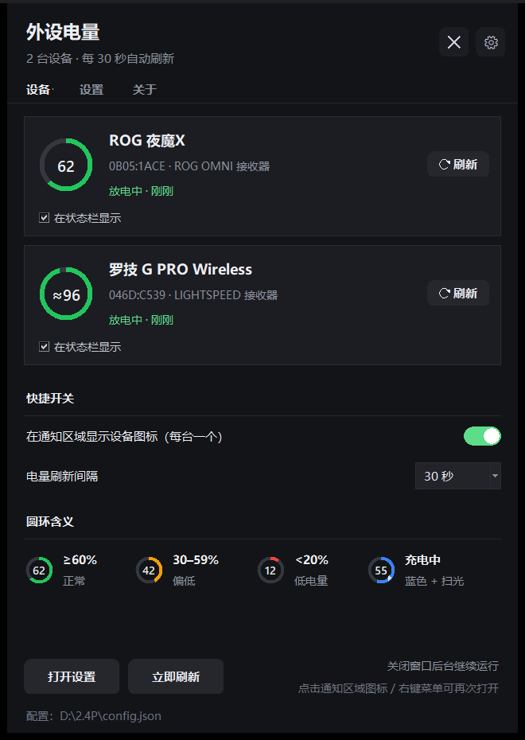
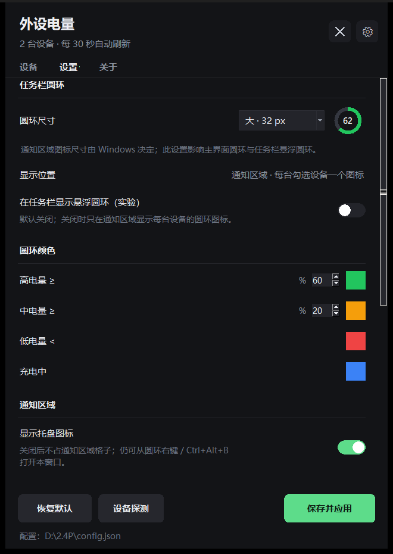
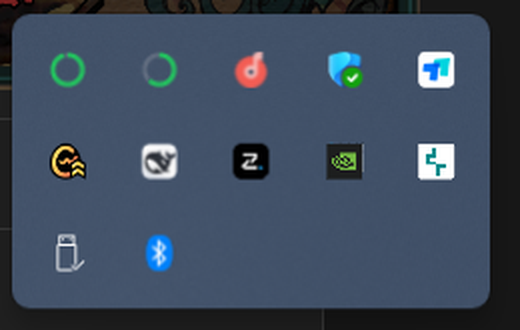
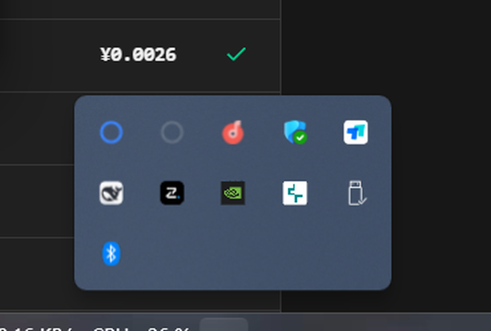
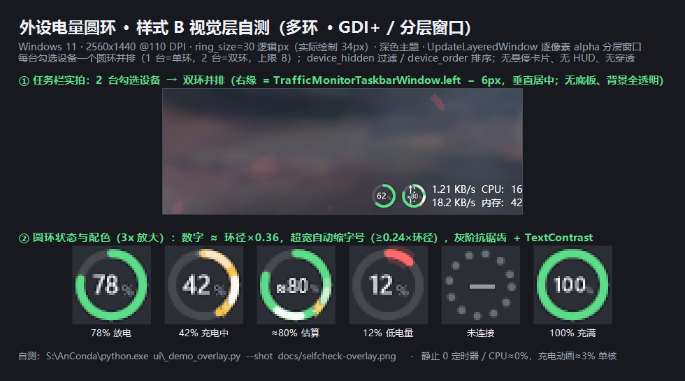

# 外设电量圆环（PeripheralBatteryRing）

在 Windows 任务栏（状态栏）里用**圆圈动画**实时显示无线外设的电量与充电状态；支持多台设备、可隐藏托盘图标、开机自启。主程序界面包含设备页 / 设置页 / 关于页。

- 纯 Python 3.10+ + 标准库（`ctypes` / `tkinter`），**零第三方依赖**
- **不联网、不写日志、只读查询设备**，不需要管理员权限
- 已在真机验证：ROG 夜魔X（Azoth X）+ 罗技 G PRO Wireless
- 通知区域图标样式 + 主程序界面见下方**实机截图**

## 实机截图

**主界面 · 设备页**（ROG 夜魔X 62%、罗技 G PRO ≈96%）



**设置页**（圆环尺寸实时预览、圆环颜色自定义：高/中/低电量阈值 + 充电蓝色）



**通知区域图标**（每台勾选设备一个圆环，位于 Windows「隐藏的图标」面板）



**充电中为蓝色圆环**（有线充电时实拍）



**圆环状态与颜色对照**（样式 B：无底板、透明背景、GDI+ 抗锯齿）



---

## 功能

| 功能 | 说明 |
|---|---|
| 通知区域图标 | 每台"勾选显示"的设备一个圆环图标；颜色分级（可自定义）；**充电中为蓝色**并有扫光；**鼠标悬停显示设备名+电量+当前状态**；电量变化与充电有动画 |
| 任务栏悬浮圆环（可选） | 实验功能：默认关闭，可在设置页打开，把圆环直接画在任务栏（TrafficMonitor 左侧） |
| 有线 USB 直连 | 设备改用有线时也能识别：罗技 HID++ 直连（已真机验证）、ROG 直连（尽力支持） |
| 多设备 | 软件里勾选要显示的设备，数量不限（超过 8 台或屏幕放不下时优先保留低电量设备） |
| 主程序界面 | 设备页（设备卡片 + 快捷开关 + 颜色图例）/ 设置页 / 关于页；窗口可自由缩放，记忆尺寸位置 |
| 通知区域图标 | 每台勾选设备一个圆环图标（可隐藏）；悬停显示设备名/电量/状态 |
| 开机自启 | 通过"启动"文件夹快捷方式，任务管理器 →「启动」里可见、可禁用 |
| 设备探测 | 内置 `probe.py`：枚举 HID 接口、读报告描述符、监控原始报文、试读 ROG/罗技协议 |
| 单实例 / 静默 | 单实例互斥；`pythonw` 无黑框；退出无残留进程；空闲 CPU ≈0% |

---

## 快速开始

环境要求：Windows 10/11 + Python 3.10+（含 tkinter；官方安装包默认自带）。

```bash
# 最省事：双击这两个（无黑框启动 / 请求退出）
#   启动外设电量圆环.vbs
#   停止外设电量圆环.vbs

# 命令行方式
# 常驻（无控制台；日常/开机自启用这个）
pythonw main.py

# 前台调试
python main.py --debug

# 只打印一次读数
python main.py --once

# 假数据演示（没有设备时看界面/动画）
python main.py --demo

# 打开主界面 / 指定标签页
python main.py --panel
pythonw ui/panel.py --tab 设置

# 状态 / 退出
python main.py --status
python main.py --quit
```

第一次运行会在任务栏出现圆环（若检测到设备）；右键圆环可打开菜单，双击打开主界面。

---

## 安装 / 卸载（开机自启）

```powershell
# 安装：启动项 + 桌面 + 开始菜单快捷方式（当前用户级，不请求管理员）
powershell -NoProfile -ExecutionPolicy Bypass -File .\scripts\install.ps1

# 只预览、不写文件
powershell -NoProfile -ExecutionPolicy Bypass -File .\scripts\install.ps1 -DryRun

# 卸载：删除所有快捷方式（保留程序文件）
powershell -NoProfile -ExecutionPolicy Bypass -File .\scripts\uninstall.ps1
```

安装脚本会自动探测 `pythonw.exe` 并写入 `scripts\python-path.txt`；快捷方式指向 `wscript.exe + scripts\run_hidden.vbs`，因此启动时不会闪黑框。

---

## 主程序界面

**设备页**：设备卡片（大圆环 / 设备名 / VID:PID·连接方式 / 状态·更新时间 / 单卡刷新）+「**在状态栏显示**」勾选（默认勾选，**勾选的设备才会在通知区域出现圆环图标**）+ 快捷开关（通知区域图标、刷新间隔）+ 圆环颜色图例。

**设置页**：圆环尺寸（带实时预览，影响主界面圆环与任务栏悬浮环）、显示位置、通知区域图标开关、任务栏悬浮圆环（实验，默认关）、**圆环颜色**（高/中/低电量阈值与颜色、充电颜色，默认蓝色，点击色块取色）、电量刷新间隔、开机自启、主题、设备改名、设备探测入口、恢复默认 / 保存并应用。

**关于页**：版本、隐私说明、协议致谢、配置路径。

> 取消设备页某台设备的「在状态栏显示」后，它的圆环图标会立即从通知区域消失（配置写入 `device_hidden` 并广播重载）。

---

## 圆环含义

| 状态 | 视觉 |
|---|---|
| 电量 ≥60% | 绿色弧 |
| 30–59% | 琥珀色弧 |
| <20% | 红色弧（低电量） |
| 充电中 | 琥珀色弧 + 沿环扫动的亮弧 + 闪电徽标 |
| 已充满 | 满环 |
| 未知 / 未连接 | 灰色虚线环 + `—` |

- 环内数字是电量；电压估算的机型显示 `≈77`（罗技老鼠标只有电压特性）。
- 状态中的「（推断）」表示充电状态不是协议直读，而是根据电量趋势/连接方式推断。

---

## 已支持设备

| 设备 | 连接 | 读数方式 | 状态 |
|---|---|---|---|
| ROG 夜魔X（Azoth X，PID 0x1C25） | ROG OMNI 接收器 0B05:1ACE | 私有 HID 协议 `12 01`：电量 `[6]`、充电 `[9]==1` | ✅ 真机验证 |
| 罗技 G PRO Wireless 等 LIGHTSPEED 设备 | 046D:C539/C53A/… 接收器 | HID++ 2.0：`0x1004/0x1000/0x1001/0x1F20`，电压按曲线估算 | ✅ 真机验证 |
| 其他 ROG 键鼠（Azoth/Falchion/Gladius/Harpe/Keris…） | OMNI / 2.4G / 有线 | 同协议事实表（部分型号未逐一真机验证） | ⚠️ 部分未验证 |
| 罗技 Unifying / Bolt 接收器 | 046D:C52B/C532/C548 等 | 同上 | ⚠️ 未真机验证 |
| 标准 HID 电量设备 / 蓝牙 PnP 电池 | 系统 HID / 蓝牙 | Battery Strength / Windows PnP 属性 | 兜底 |
| ATK/VXE（373B:1216）、DARKRIM（3654:6901） | USB 接收器 | 参考项目已验证协议（本机无设备） | 代码就绪，未真机验证 |
| Sony DualSense | 蓝牙 | HID 报告 0x31 | 协议就绪，未真机验证 |

新设备可用 `python probe.py` 摸协议，或在设置页打开设备探测。

---

## 设备探测工具

```bash
python probe.py list          # 枚举 HID 接口（VID/PID/usage/报告长度）
python probe.py desc <n>      # 查看第 n 个接口的 HID 能力与 Feature Report
python probe.py report <n> [--rid 0x01]
python probe.py watch <n>     # 监控原始 Input Report
python probe.py rog           # 试读 ROG OMNI 配对的键盘/鼠标电量
python probe.py logi          # 试读罗技 HID++ 设备电量
python probe.py export out.json
```

---

## 配置

`<程序目录>\config.json`（即 `D:\2.4P\config.json`，可手改，重启或保存后生效；旧版 `%APPDATA%` 配置首次运行会自动迁移）。主要字段：

| 字段 | 说明 |
|---|---|
| `ring_size` | 圆环逻辑尺寸（24–36，影响主界面圆环与任务栏悬浮环） |
| `device_hidden` | 不在状态栏显示的 device_id 列表 |
| `device_order` | 状态栏圆环顺序（device_id 列表） |
| `device_aliases` | 设备改名 |
| `refresh_seconds` | 电量轮询间隔（秒） |
| `show_tray_icon` | 是否显示通知区域托盘图标 |
| `theme` | dark / light / system |
| `color_levels` | 电量颜色分级，如 `[{"min":60,"color":"#22c55e"}, ...]` |
| `charging_color` | 充电状态颜色（默认 `#3b82f6` 蓝） |
| `animate` | 主界面圆环动画开关 |
| `autostart` | 只反映"启动"文件夹真实状态（由程序写入） |
| `window_x/y/width/height` | 主窗口位置与尺寸（自由缩放后记住） |

---

## 故障排查

| 现象 | 处理 |
|---|---|
| 圆环显示 `—` / "未连接" | 外设休眠或关机：敲一下键盘 / 动一下鼠标；接收器重新插拔；确认接收器在 USB 口 |
| 罗技鼠标显示 `≈` | 该型号只报电压，百分比为曲线估算，属正常 |
| 圆环位置被应用图标挤到 | 任务栏应用多时空位不足，可 Alt+拖动圆环微调（保存 offset） |
| 托盘图标被收进"隐藏图标" | Windows 默认会把新图标放进溢出区：任务栏设置 → 其他系统托盘图标 → 打开 |
| 隐藏托盘图标后找不到入口 | 双击任务栏圆环 / 右键圆环菜单 / `Ctrl+Alt+B` / 桌面快捷方式 |
| 主界面打不开 | `python main.py --panel`；或 `pythonw ui/panel.py` 看报错 |
| 开机自启失效 | 任务管理器→启动 检查是否被禁用；重跑 `scripts\install.ps1` |
| 想完全恢复默认 | 删除 `%APPDATA%\PeripheralBattery\config.json`，重新启动 |
| 圆环尺寸改了没变化 | 通知区域图标尺寸由 Windows 决定（16/24/32px），`ring_size` 影响主界面圆环与任务栏悬浮环；主界面卡片圆环会随之变大变小 |
| 通知区域找不到圆环图标 | 新图标默认在「隐藏的图标」面板里（任务栏右下角 `^`）；打开面板把圆环拖到任务栏，或 设置 → 个性化 → 任务栏 → 其他系统托盘图标 → 打开「外设电量圆环」（右键菜单里也有「把图标固定到任务栏…」直接跳转） |
| 双击 `main.py` 出现黑窗口 / 任务栏有 Python 图标 | 已加自动隐藏：用 `python.exe` 双击启动时会自动藏掉自带控制台（从 cmd/PowerShell 里运行则保留控制台）；更推荐双击 `启动外设电量圆环.vbs` 或安装后的快捷方式 |

---

## 隐私与安全

- 不联网：没有任何 http / socket / urllib 调用；
- 不写日志文件：默认不产生日志（只有 `--debug` 时控制台输出）；
- 只读设备：只发查询命令，绝不写设备设置 / 固件 / 灯光 / 配对表；
- 不请求管理员权限，不写注册表 Run（开机自启用启动文件夹快捷方式）。

---

## 目录结构

```
main.py              入口：单实例、消息循环、轮询调度、托盘/圆环/热键
启动外设电量圆环.vbs  双击无黑框启动（内部用 pythonw）
停止外设电量圆环.vbs  双击请求退出
config.py            配置读写（%APPDATA%）
models.py            数据契约（Reading/DeviceInfo）
devices/             设备层：hidiface / rog / logitech / generic / legacy / reader
ui/                  render（GDI+）、overlay（任务栏圆环）、tray（托盘）、panel（主界面）、win32
probe.py             设备探测 / 协议调试 CLI
scripts/             install.ps1 / uninstall.ps1 / run_hidden.vbs
tests/               协议解析单元测试（无需设备）
docs/                方案、设计图、实机截图、开发契约
方案.md              完整方案文档
```

> **脚本编码注意**（修改 `scripts/` 时）：`install.ps1` / `uninstall.ps1` 必须保存为 **UTF-8 with BOM**（Windows PowerShell 5.1 读中文的硬要求）；`run_hidden.vbs` 必须保存为 **UTF-16 LE with BOM**（UTF-8 会语法报错/中文乱码）。用普通编辑器另存容易丢 BOM，改完请跑一次 `install.ps1 -DryRun -NoStartup` 验证。

开发自测：

```bash
python -m unittest discover -s tests
python main.py --demo --debug
```

---

## 致谢与说明

- Logitech HID++ 协议事实来自 [Solaar](https://github.com/pwr-Solaar/Solaar)（GPL-2.0）；ASUS ROG 协议事实来自 [G-Helper](https://github.com/seerge/g-helper)（GPL-3.0）；本仓库为独立的 Python 实现，仅复用协议事实（ID、命令字节、回复偏移），未复制其代码。
- 同时参考了 [2.4G-battery-viewer](https://github.com/yszyszysz233/2.4G-battery-viewer) 的纯 ctypes HID/托盘做法。
- 私有协议部分仅用于学习与个人使用。

**版本**：0.9（2026-10-21）　**状态**：可用；多显示器副屏、任务栏自动隐藏判定等场景待真机补验。
