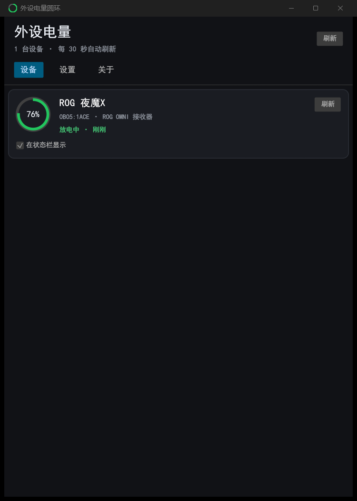
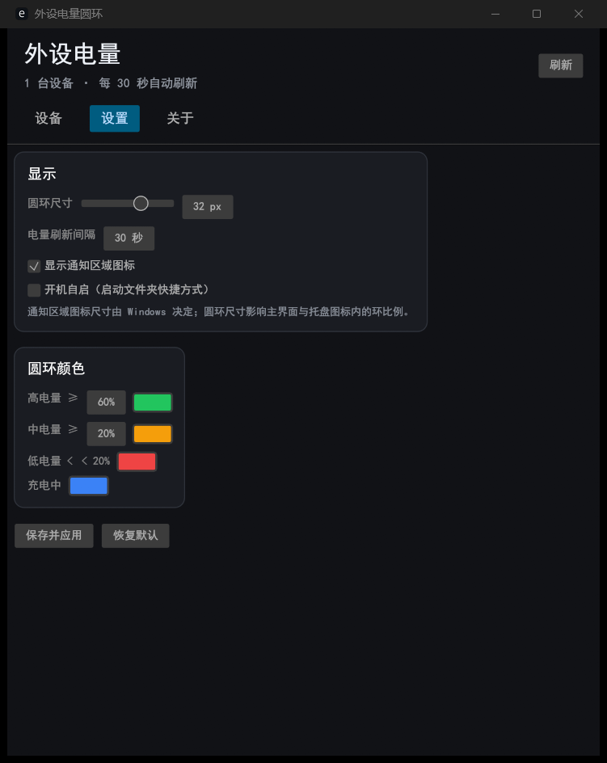
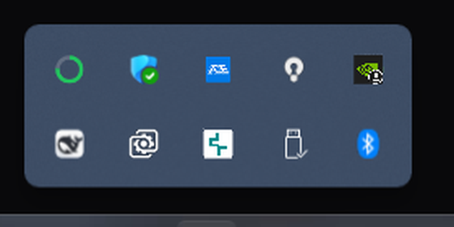

# 外设电量圆环 · Rust 版

Python 版的 Rust 重写：**单个独立 exe**（静态链接 VC 运行库），不需要 Python / .NET / 第三方运行时。
托盘图标 + 原生 Win32 消息循环（`windows` crate），主界面用 `egui`，设备读取用 `hidapi`。

> 目录：`rust/peripheral-battery-ring/`；构建产物在 `target/release/peripheral-battery-ring.exe`，
> 仓库发布页提供现成 exe（`PeripheralBatteryRing.exe`）。

## 功能

- **通知区域图标**：每台勾选设备一个圆环（颜色随电量/充电状态），tooltip 显示 `设备名：电量 · 状态`
- **右键菜单**：打开主界面 / 立即刷新 / 显示通知区域图标 / 开机自启 / 退出
- **主界面（egui）**：设备页（圆环卡片 + 「在状态栏显示」勾选）、设置页（圆环尺寸、刷新间隔、托盘图标、开机自启、电量颜色分级、充电颜色）、关于页
- **配置文件**：`<exe 目录>\config.json`（首次运行自动从旧 `%APPDATA%\PeripheralBattery\config.json` 迁移，并保留未知字段）
- **单实例** + 全局热键 `Ctrl+Alt+B` 打开主界面；UI 为独立进程（`--ui`），托盘进程常驻
- 只读查询设备，不联网、不写日志

## 设备支持

| 设备 | 状态 |
|---|---|
| ROG 夜魔X（ROG OMNI 接收器 0B05:1ACE） | ✅ 真机验证（键盘 76%） |
| 罗技 HID++ 接收器（C539 等）/ 有线直连 | 代码已实现，测试时本机鼠标不在线，未完成 Rust 版真机复测 |
| ROG 有线直连 / ATK/DARKRIM / 通用 HID / 蓝牙 | ❌ 未移植（Python 版有） |
| 任务栏悬浮圆环、托盘充电动画 | ❌ 未移植（主界面充电扫光保留） |

## 构建

需要 Rust 1.80+ 与 MSVC Build Tools（`x86_64-pc-windows-msvc`）。

```powershell
cd rust\peripheral-battery-ring

# 静态链接 VC 运行库，产出可独立分发的 exe
$env:RUSTFLAGS = "-C target-feature=+crt-static"
cargo build --release

# 产物
# target\release\peripheral-battery-ring.exe
```

依赖：`windows`（Win32）、`hidapi`（HID）、`serde/serde_json`（配置）、`eframe/egui`（界面）。

## 运行

```powershell
# 常驻托盘
PeripheralBatteryRing.exe

# 打开主界面（内部参数，由托盘/热键自动调用）
PeripheralBatteryRing.exe --ui

# 调试输出（仅 debug 构建有控制台）
$env:PBR_DEBUG=1
cargo run
```

退出：托盘图标右键 → 退出。开机自启：设置页勾选，会在
`%APPDATA%\Microsoft\Windows\Start Menu\Programs\Startup\外设电量圆环.lnk` 创建快捷方式。

## 截图






