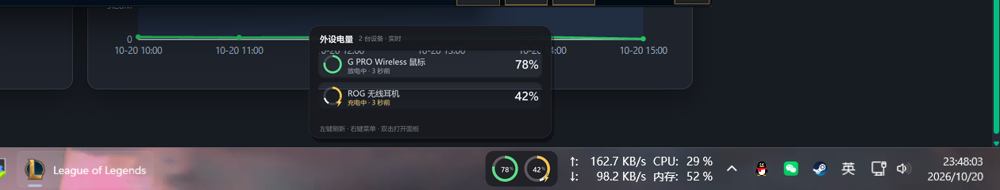
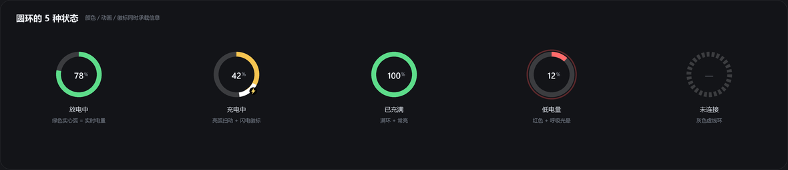
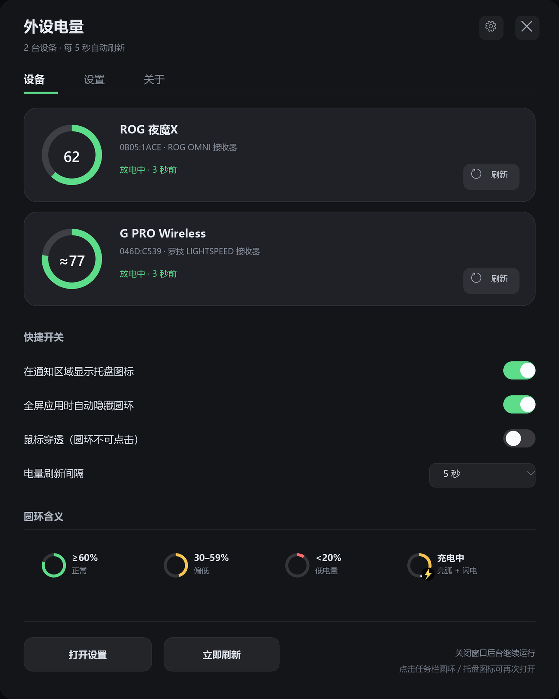
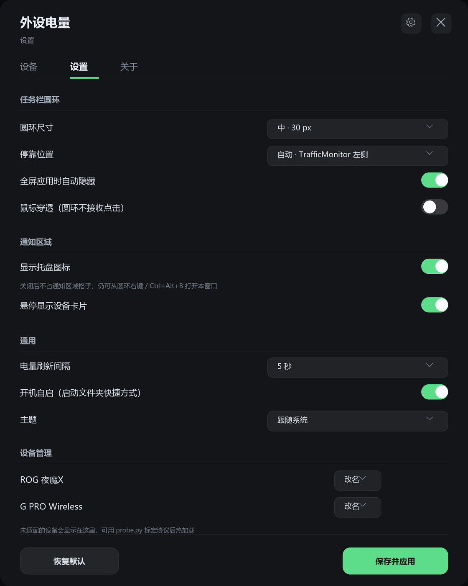
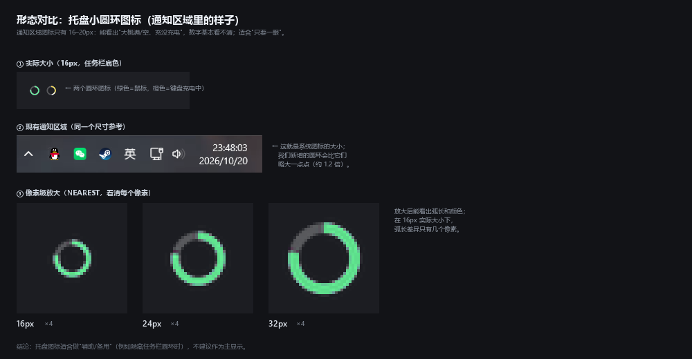

# 外设电量 · Windows 状态栏圆环工具 —— 方案 v1

> 目标：一个 Windows 常驻小工具，在任务栏（状态栏）里用**圆圈动画**实时显示 2.4G / 蓝牙外设的电量与充电状态；软件端可隐藏任务栏图标；轻量、零第三方依赖、开机自启。

---

## 0. 一句话方案

**Python 3.12 + ctypes（零第三方依赖）写一个常驻程序**：
用 `UpdateLayeredWindow` 在任务栏托盘区左侧叠一个逐像素透明的"圆环胶囊"窗口（已验证可行，见 §1.4），
圆环显示每台外设的实时电量，充电时亮弧扫动 + 闪电徽标；悬停弹出设备卡片；
通知区域托盘图标可选、可隐藏；设置面板用 tkinter；另带一个 HID 探测/调试工具，方便适配新设备。

---

## 0.5 已确认的决定（2026-10-21 更新）

| 问题 | 你的选择 | 落地方式 |
|---|---|---|
| 设备范围 | **自由识别，不固定设备**（键盘 ROG 夜魔X） | 启动自动扫描 + 热插拔重扫；发现多少显示多少，未适配设备明确标注；另带 `probe.py` 手动标定新协议 |
| "隐藏任务栏图标" | **C：两者都要** | ① 通知区域托盘图标可隐藏；② 面板/主窗口不产生任务栏按钮（工具窗口样式，默认就没有） |
| 充电状态 | **A：接受推断** | 协议有充电标志就直读；没有就用"插线/电量持续上升"推断并标注"(推断)"；仍不伪造确定状态 |
| 状态栏样式 | **待你从 5 个样式中选**（见 §3.4） | 选定后按该样式开工 |

**真机验证结果（已经用 Python ctypes 打通，不是纸上谈兵）**：

| 设备 | 身份 | 实测读数 | 协议 |
|---|---|---|---|
| **ROG 夜魔X（Azoth X）** | OMNI 接收器配对列表 PID `0x1C25` | **62%，未充电** | MI_02 col02，report `0x02`，请求 `12 01`；回复 `[6]`=电量、`[9]`==1 表示充电中 |
| **罗技 G PRO Wireless** | `046D:C539` 接收器槽位 1，名称 "G Pro Wireless Gaming Mouse" | **3967 mV ≈ 77%（电压估算），未充电** | HID++ 2.0：MI_02 短集合 `0x10` 请求；特性 `0x1001` 电压（大端 mV），`data[2]` bit7 = 充电中 |

> 结论：**你现有的两台无线外设都能读到电量与充电状态**，其中键盘的协议事实来自 G-Helper、鼠标来自 Solaar（见 §1.5 的参考实现），充电标志的真机确认只需你插一次线配合验证。

---

## 0.6 最终确认（2026-10-21，用户拍板）

- **架构：方案 A（双进程）** —— 常驻主进程（Win32 消息循环：任务栏圆环 + 托盘）+ 按需启动的主窗口进程（tkinter，可自由缩放），配置 JSON + 广播消息解耦。
- **状态栏显示**：软件里勾选要显示的设备，**数量不限**（1 台=单环，N 台=N 环并排；`config.device_hidden` 取反）。
- **删除**：悬停卡片、HUD 悬浮、全屏自动隐藏、鼠标穿透（设置页对应开关一并删除）。
- **字体优化**：环内数字 Segoe UI Semibold、字号加大 + 自动收缩；GDI+ ClearType；主窗口微软雅黑 UI 10pt、最小 9pt。
- **主窗口**：自由拉伸 + 布局自适应（最小 480×560，滚动、记忆尺寸/位置）。
- **设备探测入口**：设置页按钮启动 `probe.py`。

## 1. 我看了什么（素材调研 + 本机实测）

### 1.1 GitHub 项目 `yszyszysz233/2.4G-battery-viewer`

`git clone` 被网络拦截，已通过 GitHub API 把全部 13 个文件取回本地（`_ref/repo/`）。要点：

| 方面 | 结论 |
|---|---|
| 定位 | 不是通用工具，只针对 **ATK/VXE 鼠标 `373B:1216`** 与 **DARKRIM SHADOW 耳机 `3654:6901`** 逆向了协议 |
| 技术栈 | 纯 ctypes + tkinter，零第三方依赖；`hid_win.py`（SetupAPI/HID 枚举与读写）、`battery.py`（多策略电量：标准 HID 电量字段 → 厂商协议 → 罗技 HID++ 2.0 → 监听 Input Report → 手动标定）、`tray_app.py`（托盘）、`win_icon.py`（纯 Python 画图标）、`win_link.py`/`win_shell.py`（快捷方式） |
| 可复用 | HID 枚举/读写层、罗技 HID++ 2.0 后端雏形、协议标定 JSON、托盘消息循环与单实例、开机自启/快捷方式思路 |
| 已知坑（直接继承） | ① 同一 HID 句柄"阻塞读 + 写"会直接杀进程 → 读要用独立 `OVERLAPPED` 句柄 + `CancelIoEx`；② 系统独占的顶层集合只能 `dwDesiredAccess=0` 打开；③ 销毁托盘窗口后必须 `PostQuitMessage`，否则留僵尸进程占单实例锁；④ Tkinter 非线程安全（`queue` + `after` 回主线程）；⑤ 托盘图标不能"删了再加、用 NIM_MODIFY 改回"；⑥ 不做 DPI 声明图标会糊；⑦ 别自动"纠正"用户的开机自启设置 |
| 结论 | **方法可借鉴、部分模块可移植，但不能直接当成我们的成品**——它是"两台特定设备"的桌面面板+托盘数字图标，没有状态栏圆环、没有充电状态、没有隐藏托盘图标的完整链路 |

### 1.2 文件夹里的网页

工作目录 `D:\2.4P` 是空的；上一轮工作区（`D:\2.4W`）在 22:35 被删进了回收站。我从回收站恢复了它，网页是：

> `网页\在线USB设备查看器 - 检查VID、PID与HID设备信息 _ CoderTools.html`

即 **CoderTools 的在线 USB/HID 查看器**（基于浏览器 WebHID API）：能选设备、看 VID/PID、产品名、HID 集合、报告描述符（Hex / C 数组）、输入报告监控、导出 JSON。
它和这个工具的关系：**不是 UI 参考，而是"设备探测"能力的参考** —— 本方案会把这套能力做成工具内置的 `probe.py`（原生 HID 版本，不依赖浏览器），用来枚举接口、抓原始报文、验证新设备的电量协议。

> ⚠️ 如果你说的"网页"是另一份（比如 UI 设计稿），请把它放进 `D:\2.4P` 并告诉我，我按它调整视觉。

### 1.3 本机环境与硬件实测

| 项目 | 实测结果 |
|---|---|
| 系统 | Windows 11 Pro（注册表 `ProductName` 仍写 Windows 10 Pro），**Build 26300.9711 / DisplayVersion 26H2** |
| 显示 | 单屏 2560×1440；任务栏在底部，高 **54px**；DPI **110**（≈115% 缩放） |
| 任务栏窗口 | `Shell_TrayWnd` 0,1386–2560,1440；`TrayNotifyWnd`（通知区域）2205–2560 |
| **TrafficMonitor** | 已在运行，任务栏窗口 `#32770 "TrafficMonitorTaskbarWindow"` 占 **2009–2207**（198×36），紧贴托盘区左侧 —— **圆环必须停靠在它左边，否则会盖住网速/CPU/内存显示** |
| Python | `S:\AnConda\python.exe` 3.12.7 + tkinter 8.6；`pythonw.exe` 可用；**无 `py` launcher**；numpy/Pillow 恰好有（但方案仍按零依赖设计，可选加速） |
| 构建工具 | dotnet 有、node 有；**cl/gcc/cargo 都没有**（所以"做 C++ TrafficMonitor 插件"这条路过不了，见 §14） |
| 本机外设（HID） | 罗技 **PRO WIRELESS 接收器 046D:C539**（G PRO Wireless 鼠标）、罗技 G431 有线耳机 046D:0A9B（无电池）、**ROG OMNI RECEIVER 0B05:1ACE**（配对 **ROG 夜魔X / Azoth X，PID 0x1C25**）、ASUS AURA 控制器 0B05:19AF（主板）、**Sony DualSense（蓝牙）054C:0CE6** |
| 目标设备 | 仓库那两台（373B:1216 / 3654:6901）在本机**从未连接过**；按你的要求改为**自由识别**，本机键盘/鼠标已实测可读（见 §0.5、§1.6），仓库协议仍作为"如果以后插上就支持"的适配器保留 |

### 1.4 可行性验证（先跑了两个 spike）

1. **任务栏叠加窗口**（`_ref/poc_overlay.py`，纯 ctypes）：
   在 `(2135,1390)` 建 62×46 `WS_EX_LAYERED|TOPMOST|TOOLWINDOW` 窗口，用 `CreateDIBSection` + `UpdateLayeredWindow` 逐像素 alpha 绘制圆环，30fps 循环 40 秒 —— **成功盖在任务栏上方、不抢焦点、圆环抗锯齿正常、不影响 TrafficMonitor 自身绘制**。实机截图见 `docs/02-实机叠加验证.png`（截图里压在 CPU 文字上的蓝色圆环就是它）。
2. **渲染性能基准**（`_ref/bench_ring.py`）：纯 Python 光栅化 96×46 圆环，2× 超采样 **4.3ms/帧 → 30fps 约占单核 13%**；因此最终渲染用 **GDI+（系统自带，C 速度，零依赖）**，实测应 <1%；纯 Python 版留作降级备选。

### 1.5 意外找到的同目标参考：`SteveWang92/peripheral-battery-tray`（Rust）

在 GitHub 上搜到的一个**正好覆盖 ASUS ROG + 罗技无线外设**的 Rust 托盘工具（另一份 MIT 实现，2026-10 仍在更新；作者另有归档版 `rog-battery-tray`）。它的价值是**协议事实**：
- `crates/rog-battery/src/lib.rs`：ROG 私有 HID 协议（接收器配对列表、键盘 `12 01` / 鼠标 `12 07`、回复偏移、无应答 `FF AA`、OMNI/2.4G/有线三种通道）；
- `crates/logitech-battery/src/lib.rs`：HID++ 2.0（短/长集合、`0x1004/0x1000/0x1001/0x1F20` 电量特性、接收器槽位、配对短名、软件 ID）；
- 它自己声明：协议事实来自 **Solaar（GPL-2.0）** 与 **G-Helper（GPL-3.0）**，代码是独立 MIT 实现。

**我们用它的"事实"（ID、命令字节、回复偏移），用 Python 重写代码**，并在 README 里注明来源，不复制其代码。这样既快又干净。

### 1.6 真机协议验证记录（本轮实测）

**ROG 夜魔X（Azoth X）→ OMNI 接收器**（`_ref/probe_rog.py`）：

```
配对列表 (MI_02 col01, rid 0x01, "A0 00"):
  01 a0 00 01 00 [25 1c] 02 04 ...        → paired PID = 0x1C25 (ROG Azoth X)
键盘电量 (MI_02 col02, rid 0x02, "12 01"):
  02 12 01 00 00 00 3e 03 01 00 14 3e 45 0f ...
                  ^^[6]=0x3E=62%          ^^[9]=0x00 未充电
鼠标通道 (MI_02 col03, rid 0x03, "12 07"):
  03 ff aa ...                            → FF AA = 该槽位没设备（正常）
```

**罗技 G PRO Wireless → Lightspeed 接收器**（`_ref/probe_logitech.py`）：

```
HID++ 短集合 0x10 请求 → 长集合收回复
槽位 1 短名 "G Pro"，设备名 "G Pro Wireless Gaming Mouse"
特性 0x1001 (Voltage) idx=0x06 → 0f 7f 00 00 ...  = 3967 mV，data[2]&0x80=0 未充电
（0x1004/0x1000 不支持 → 该鼠标只用电压特性；按锂电池曲线估算约 77%，显示时标注"约"）
```

> 待验证的只有"充电标志"：需要你分别给键盘/鼠标插一次线，我们读一下 `[9]` / `bit7` 是否置位，即可把充电动画接上。

---

## 2. 需求拆解

| 需求原文 | 本方案落地 | 说明 |
|---|---|---|
| 显示外设设备电量和充电状态 | 多设备状态模型：电量 % + 状态（放电/充电中/已充满/未连接/未知）| 后端按设备协议读取；详见 §5 |
| 电量在 Windows 状态栏显示 | 任务栏内部叠加"圆环胶囊"窗口，停靠在 TrafficMonitor 左侧（无 TM 时贴托盘区左侧）| 已实测可行；见效果图 1 |
| 以圆圈动画的方式显示实时电量 | 圆环弧长 = 电量；颜色分级；**充电中亮弧扫动 + 闪电徽标**；电量变化时弧长平滑过渡；低电量红色呼吸 | 动画只在充电/变化/悬停时跑 30fps，静止时 0 CPU |
| 软件端支持隐藏任务栏图标 | 设置里的"显示托盘图标"开关：关掉后从通知区域移除图标，圆环右键 / 双击 / `Ctrl+Alt+B` / 开始菜单快捷方式仍可打开面板与菜单；程序本身不产生任务栏按钮 | 两个"任务栏图标"含义都覆盖 |
| 常驻/轻量 | 单实例、SetTimer 驱动、后台线程读设备、默认 5s 刷新、无日志文件、不联网 | 继承参考项目的工程约束 |

---

## 3. 交互与视觉设计

### 3.1 状态栏圆环（主界面）



- 圆环胶囊 ≈ 92×46 px（随 DPI 缩放），停靠在 **TrafficMonitor 任务栏窗口左侧**，与托盘区留 6px 间距；TrafficMonitor 窗口宽度变化/关闭时自动重排。
- 每台设备一个圆环（1–3 台），环内显示百分比；充电设备右下方一个小闪电徽标。
- 悬停：向上展开深色设备卡片（设备名 / 百分比 / 状态 / 更新时间）；卡片同样用叠加窗口绘制，风格统一。
- 交互：左键单击 = 立即刷新；双击 = 打开设置面板；右键 = 菜单（打开面板 / 立即刷新 / 隐藏托盘图标 / 开机自启 / 退出）；滚轮 = 切换设备/刷新（可选）。
- 全屏应用、任务栏自动隐藏时自动隐藏；退出全屏自动恢复。

### 3.2 圆环状态语义



| 状态 | 视觉 |
|---|---|
| 放电中 | 绿色实心弧（≥60 绿 / 30–59 黄 / <30 红），弧长 = 电量 |
| 充电中 | 琥珀色弧 + 沿环扫动的白色亮弧（动画）+ 闪电徽标 |
| 已充满 | 满环常亮 + 状态文案"已充满" |
| 低电量 | 红色弧 + 外圈呼吸光晕（低电量时轻微脉动） |
| 未连接 | 灰色虚线环 + "—" |
| 读数中/异常 | 灰色环 + 小问号/省略号，tooltip 给原因（如"动一下鼠标"） |

### 3.3 主程序窗口（设备页 + 设置页）

> **这是"主程序的 UI"**：从任务栏圆环（双击）/ 托盘图标（左键）/ 右键菜单打开；关闭窗口后仍在后台运行。



**设备页（主界面）**
- 顶部：设备数量与刷新状态；`设备 / 设置 / 关于` 三个标签页；
- 设备卡片：大圆环（弧长=电量，颜色分级，充电时亮弧+闪电）+ 设备名 + VID:PID/连接方式 + 状态与更新时间 + 单独"刷新"；
- 快捷开关（不用进设置页就能改）：显示托盘图标 / 全屏自动隐藏 / 鼠标穿透 / 电量刷新间隔；
- 圆环含义图例（颜色与充电动画说明），降低理解成本；
- 底部：打开设置 / 立即刷新；右侧提示"关闭窗口后台继续运行"。



**设置页**
- 任务栏圆环：尺寸（小 24 / 中 30 / 大 34）、停靠位置（自动 / 任务栏 / 悬浮 / 自定义）、全屏自动隐藏、鼠标穿透；
- 通知区域：显示托盘图标（"隐藏任务栏图标"开关）、悬停卡片；
- 通用：刷新间隔、开机自启（读写启动文件夹真实状态）、主题；
- 设备管理：改名、隐藏未适配设备、查看设备 ID；底部"恢复默认 / 保存并应用"。

**窗口规格**：逻辑尺寸 560×700（随 DPI 缩放），深色主题；`WS_EX_TOOLWINDOW` 不产生任务栏按钮；关闭 = 隐藏到后台；配置保存后立即广播 `PeripheralBattery_Reload` 让常驻进程重载。

### 3.4 任务栏圆环样式选项（← 待你选）


| 样式 | 名称 | 特点 | 适合 |
|---|---|---|---|
| **A** | 双环胶囊（推荐） | 圆角底板 + 两环 + 环内百分比 | 默认最稳，耐壁纸/透明变化 |
| **B** ✅ 已选 | 无底板双环 | 圆环直接浮在任务栏上（最终效果见 `docs/08`、`docs/09`） | 喜欢"系统原生感"、深色任务栏 |
| **C** | 单环合并 | 只显示电量最低的一台，悬停展开全部 | 极简、任务栏空间紧张 |
| **D** | 环 + 名称 | 小环 + 设备名 + 百分比，两行 | 设备多、想一眼分清谁是谁 |
| **E** | 极简双环 | 只有颜色/弧长，无数字 | 最不打扰 |

> **已选定：B 无底板双环（2026-10-21 用户确认）**，最终确认图见 `docs/08-样式B-实机位置.png` 与 `docs/09-样式B-规格确认.png`。
> 所有样式共用：悬停卡片、左键刷新、双击面板、右键菜单、充电动画。
> 待用户确认的具体参数：环径（默认中 30 逻辑 px）/ 环内数字写法（数字，估算加 ≈）/ 卡片内容 / 拥挤时悬浮兜底（见 §6.2）。

### 3.5 托盘图标（辅助形态，可隐藏）



- 16–20px 的通知区域图标：能看出"大概满/空、充没充电"，但**数字基本看不清**。
- 定位：作为辅助显示（主圆环隐藏时/任务栏空间不足时的降级），以及"隐藏任务栏图标"开关的对象。
- 悬停 tooltip 给精确数值；左键弹出设备卡片。

---

## 4. 总体架构（方案 A，已确认）

```
┌───────────────────────────── 主进程 main.py（单实例 + 消息循环）─────────────────────────────┐
│                                                                                              │
│  devices/ 设备读取层（后台线程，可插拔后端）        ui/ 界面层（主线程 + Win32 消息）          │
│  ├─ hidiface.py  HID 枚举/异步读/Feature Report    ├─ overlay.py  任务栏圆环叠加窗口(ULW)      │
│  ├─ logitech.py  HID++ 2.0（罗技接收器）           ├─ render.py   GDI+ 圆环/文字/图标渲染      │
│  ├─ dualsense.py DualSense 报告 0x31              ├─ tray.py      Shell_NotifyIcon + 菜单      │
│  ├─ rog.py       ASUS ROG OMNI（已验证）           ├─ hover.py     悬停设备卡片（叠加窗口）     │
│  ├─ atk.py       373B:1216（移植仓库协议）         └─ panel.py     tkinter 设置面板             │
│  ├─ darkrim.py   3654:6901（移植仓库协议）                                                     │
│  ├─ generic.py   标准 HID 电量 / 蓝牙 PnP 电池属性  config.py     配置读写（%APPDATA%）         │
│  └─ reader.py    调度、缓存、充电状态推断           probe.py      设备探测/协议调试 CLI          │
│                                                                                              │
│  scripts/ install.ps1 · uninstall.ps1 · run_hidden.vbs（自启/快捷方式/无黑框启动）             │
└──────────────────────────────────────────────────────────────────────────────────────────────┘
```

**技术选型理由**

| 选择 | 理由 |
|---|---|
| Python + ctypes | 本机 Python 3.12 已就绪；参考项目验证了"纯 ctypes 能做完 HID + 托盘 + 图标"；零第三方依赖、改起来快、无需编译 |
| 不用 C#/WPF | 同样要 P/Invoke Win32 做任务栏叠加/托盘；发布体积与运行时是额外负担；本机 dotnet 虽有但无必要 |
| 不用 C++ Win32 | 效果最好但开发/迭代成本高；且本机无 cl/gcc/cargo，无法编译 TrafficMonitor 插件 |
| 不用 Electron/WebView2 | 内存 100MB+，任务栏逐像素透明仍要 Win32 层；不划算 |
| 渲染用 GDI+ | 抗锯齿弧线/文字/渐变是系统自带能力，ctypes 调 flat API 即可，CPU 近 0；比纯 Python 光栅化（13% 单核@30fps）好一个量级 |
| 不用 Win11 Widgets / DeskBand | 第三方桌面程序没有任务栏 widget API；DeskBand 在 Win11 已不支持 |
| 不做 TrafficMonitor 插件 | 宿主耦合 + 需要 C++ 编译链 + 与"独立软件、可隐藏自己的图标"目标冲突；留作备选 |

---

## 5. 设备读取层

### 5.1 后端矩阵（按优先级）

| 后端 | 设备（本机实测） | 电量 | 充电状态 | 状态 |
|---|---|---|---|---|
| **ASUS ROG OMNI**（新增，已验证） | `0B05:1ACE`：MI_02 col01=配对列表、col02=键盘、col03=鼠标 | 键盘：`12 01` 回复 `[6]`；鼠标：`12 07` 回复 `[5]`（0–4 档 ×25） | 键盘 `[9]==1`；鼠标 `[10]!=0`；无应答=`FF AA` | ✅ 真机验证：夜魔X 62%，未充电 |
| **Logitech HID++ 2.0**（已验证） | `046D:C539` Lightspeed 接收器（MI_02 短/长集合） | 特性 `0x1004`→`0x1000`→`0x1001`→`0x1F20` 依次尝试；本机鼠标只有 `0x1001` 电压（3967 mV） | `0x1000/0x1004` 状态字节 1–4=充电；`0x1001` `data[2]` bit7；`0x1F20` bit1 | ✅ 真机验证：G PRO Wireless 约 77%，未充电 |
| **Sony DualSense** | `054C:0CE6`（蓝牙，本机已连） | HID 输入报告 `0x31` 的电量 nibble（`0–10` → `%`） | 同报告上半字节：放电/充电/充满 | 协议公开，待真机验证 |
| **ATK/VXE 鼠标** | `373B:1216`（本机未接） | 仓库已验证：usage page `0xFF05`，Report ID `0x08`，请求 `7D 72 02 00 01 07 01`，回复第 7 字节 | 仓库协议没有；需借 `probe.py` 在"插线充电"时找充电位 | 协议照抄，设备未接 |
| **DARKRIM 耳机** | `3654:6901`（本机未接） | 仓库已验证：杰理 TLV `0x01` 首字节 | TLV `0x01` 后续字节 / `0x06` 状态码待确认 | 协议照抄，设备未接 |
| **通用 HID 电量** | 任意符合标准 HID 电量字段的设备 | 标准用法页 `0x0006/0x0020`（Battery Strength）、`0x0001/0x0006` | 一般无 → 推断或未知 | 兜底 |
| **蓝牙 PnP 电池** | 蓝牙耳机/手柄等 | Windows 未公开 PnP 属性 `{104EA319-6EE2-4701-BD47-8DDBF425BBE5},2` | 一般无 | 兜底 |

**「自由识别」发现流程**（每次启动 + 热插拔 + 每 60s 轻量重扫）：

```
枚举全部 HID 接口
├─ ASUS 0B05:1ACE → 读配对列表（col01）→ 对每个配对 PID 调键盘/鼠标协议 → 有应答就列出
├─ ASUS 其他 PID（有线/2.4G）→ 按通道模板探测 → 识别型号名
├─ 罗技 046D:* 接收器（C539/C53A/…）→ HID++ 读 1–6 槽位短名 → 逐个探测电量特性
├─ 标准 HID 电量字段 / 蓝牙 PnP 属性 → 直接读
└─ 其他设备 → 只列出"发现但未适配"，可在 probe.py 里标定后热加载
```

> 设计成**插件式后端**：每台设备一个 backend，统一返回 `Reading`；新设备只要在 `probe.py` 里摸出协议，加一个 30 行的 adapter 或一条 JSON 标定即可。

**统一数据契约**（先定接口，三个并行开发分支按它对接）：

```python
@dataclass
class Reading:
    device_id: str            # 稳定 ID：vid:pid#serial 或用户自定义名
    name: str                 # 显示名（可被用户改写）
    level: int | None         # 0-100，None=读不到
    status: str               # discharging|charging|full|unknown|unplugged|error
    source: str               # 后端名（用于 tooltip/调试）
    voltage_mv: int | None
    updated_at: float
    detail: str = ""          # 失败原因/提示（如"动一下鼠标"）
```

### 5.2 充电状态策略（诚实优先）

1. **协议直读**（首选，已确认字段）：
   - ROG 键盘：`12 01` 回复 `[9] == 1` → 充电中；
   - ROG 鼠标：`12 07` 回复 `[10] != 0` → 充电中；
   - 罗技：`0x1000/0x1004` 状态 1–4 → 充电中；只有 `0x1001` 电压的机型看 `data[2]` bit7；
   - DARKRIM：TLV `0x01` 后续字节 / `0x06` 状态码（待真机确认）；
2. **连接模式推断**：设备插线充电时往往以"有线设备"重新枚举（VID/PID 或接口集合变化）→ 标记"充电中(推断)"；
3. **电量趋势推断**：窗口内电量单调上升（例如 20 分钟内 +2% 以上）→ "充电中(推断)"；
4. **兜底**：显示"未知"并给出提示，**绝不瞎猜成"充电中"**。

### 5.3 继承参考项目的坑（写进代码规范）

- HID 句柄：写用主句柄、收 Input Report 用独立 `FILE_FLAG_OVERLAPPED` 句柄 + 事件超时 + `CancelIoEx`；避免"阻塞读 + 并发写"；
- 系统独占的键盘/鼠标顶层集合 `dwDesiredAccess=0` 打开；
- Win64 ctypes 必须给所有指针返回值的 API 声明 `restype=c_void_p`（spike 里被坑过：句柄被截断成 int 溢出）；
- 验证 GDI+ 输出 alpha：`UpdateLayeredWindow` 要求**预乘 alpha**；
- Tkinter 只在主线程；托盘/叠加窗口状态变更走 `PostMessage` 回主线程；
- 设备休眠时短超时（300–500ms）失败即返回，别让 UI 卡住。

---

## 6. 状态栏圆环实现

### 6.1 窗口与渲染

- 窗口：`WS_POPUP` + `WS_EX_LAYERED | WS_EX_TOPMOST | WS_EX_TOOLWINDOW | WS_EX_NOACTIVATE`；`UpdateLayeredWindow(ULW_ALPHA)` 逐像素透明，兼容任务栏圆角/亚克力背景。
- 渲染：GDI+ flat API（`GdiplusStartup` / `GdipCreateFromHDC` / `GdipDrawArc` / `GdipDrawString` …）画到 32bpp DIB；输出前做预乘 alpha；DPI 变化时重建位图。
- 圆环：底环 + 进度弧（-90° 起）+ 充电亮弧（动画段）+ 闪电徽标 + 居中百分比文字（Segoe UI Semibold / 微软雅黑）。
- 悬停卡片：第二个同款叠加窗口，圆角深色面板 + 行项目；超出屏幕边界时自动翻转/夹紧。

### 6.2 定位算法（每 500ms / 收到 `WM_SETTINGCHANGE`、`TaskbarCreated` 时重算）

```
Shell_TrayWnd 矩形 → 判定任务栏在底/顶/左/右
  → 找子窗口 #32770 "TrafficMonitorTaskbarWindow"
       有：首选的圆环右边缘 = TM.left - 6
       无：首选的圆环右边缘 = TrayNotifyWnd.left - 6
  → 检查该位置是否与任务栏上的应用按钮重叠（本节下方说明）
       不重叠 → 用之
       重叠   → 在任务栏上向左找最近的空位（按检测到的按钮区域）
       找不到空位 → 降级：① 单环紧凑模式（只显示电量最低的一台）→ ② 悬浮在任务栏上方的 HUD 模式
  → 垂直居中于任务栏；夹紧到任务栏可见区域
  → 用户按住 Alt 拖动可覆盖自动位置（记住偏移，存配置）
  → 多显示器时按配置选择目标显示器（本机单屏，先做主屏）
```

**为什么需要"避让"**：本机实测发现任务栏是左对齐的，应用开多了按钮会一直长到 TrafficMonitor 左侧 —— 实测截图中 2 个 League of Legends 按钮已经贴到接收器显示区，没有空位。所以：
- 首选空位（TrafficMonitor/托盘区左侧）可用时就用；
- 按钮区域检测：优先用 UI Automation 枚举任务栏按钮矩形（拿不到时退化为"按窗口数量估算 + 用户可拖动"）；
- 实在没空位就自动降到单环/悬浮模式，**绝不去盖住应用按钮**。

### 6.3 动画

- 状态：静止（0 定时器）/ 数值过渡（300ms 缓动）/ 充电（30fps 亮弧旋转）/ 低电量呼吸（1.4s 周期）。
- 动画期间 `SetTimer(16ms)`；动画结束自动降频到 1s 心跳（防 z-order 丢失/几何变化）。
- 目标：充电动画时 CPU < 1%，静止时 ≈ 0%，内存 < 80MB。

### 6.4 隐藏/恢复逻辑

| 场景 | 行为 |
|---|---|
| 任务栏自动隐藏 | 任务栏不可见时隐藏圆环（`SHAppBarMessage(ABM_GETSTATE)` + 窗口可见性） |
| 全屏应用/游戏 | 前台窗口覆盖目标显示器且非桌面/任务栏 → 隐藏；退出全屏恢复 |
| Explorer 重启 | 监听 `TaskbarCreated` 消息，重新挂接、重算位置 |
| 显示设置变化 | `WM_DISPLAYCHANGE` / `WM_DPICHANGED` 重建尺寸与位置 |
| 托盘图标被隐藏 | 圆环仍在；右键/双击/快捷键仍可用 |

### 6.5 交互

- `WM_MOUSEMOVE` 进/出：显示/隐藏卡片；`WM_LBUTTONUP`：立即刷新；双击：打开面板；`WM_RBUTTONUP`：菜单（原生 `TrackPopupMenu`，不是 tkinter 菜单）。
- 可选"鼠标穿透"：`WS_EX_TRANSPARENT`，不接收点击（高级用户）。
- 悬浮提示兜底：即使卡片关闭，tooltip 也显示"设备：78% · 放电中 · 3 秒前"。

---

## 7. 托盘图标与"隐藏任务栏图标"

- 托盘图标：GDI+ 渲染 16/20/24/32 多尺寸 ICO（圆环 + 最小号百分比），`NIM_ADD/NIM_MODIFY`；tooltip 显示所有设备状态。
- 菜单：打开面板 / 立即刷新 / 显示托盘图标（勾选）/ 开机自启（勾选，只读真实状态）/ 退出。
- **隐藏任务栏图标**：
  - 关掉"显示托盘图标" → `NIM_DELETE`；之后入口 = 圆环右键 / 双击圆环 / `Ctrl+Alt+B` / 桌面与开始菜单快捷方式；
  - 程序主窗口/面板使用工具窗口样式 → **本来就不会在任务栏产生按钮**；
  - 该开关写入配置，重启后保持；重新显示时 `NIM_ADD`（不是 NIM_MODIFY，参考项目的坑）。
- 单实例：命名 Mutex + `RegisterWindowMessage` 广播（复用参考项目 `tray_common` 思路），退出必 `PostQuitMessage`，杜绝僵尸进程。

---

## 8. 设置面板（tkinter）

- 深色主题、圆角感（`ttk` 样式 + 自绘开关），布局见效果图 3；所有设置即时生效（写 JSON + `PostMessage` 通知常驻进程）。
- 设备列表支持改名、排序、启用/禁用、单独刷新。
- 首次运行向导：自动扫描设备 → 列出可读设备 → 让用户选择显示哪几台。
- 面板可最小化/关闭到圆环；不写日志。

---

## 9. 设备探测 / 调试工具（把网页能力本地化）

`probe.py`（CLI + 简单 Tk 窗口）复刻 CoderTools 网页 + 参考项目 `app.py` 的能力：

1. 枚举所有 HID 接口：VID/PID、产品名、usage page/usage、in/out/feature 长度、是否系统独占；
2. 读报告描述符（Hex / C 数组）；读 Feature Report；
3. 探测 Report ID（0x01–0x3F 尝试）；
4. 监控 Input Report 原始报文（带时间戳、导出 JSON）；
5. 协议试发：自定义 Report ID + payload，查看回复；
6. 手动标定：把"请求/校验/电量字节下标/倍率"存成 JSON，被主程序加载；
7. 一键生成新设备 adapter 的骨架代码。

用途：适配 ROG OMNI、ATK 充电状态、以及你以后买的任何新设备。

---

## 10. 目录结构

```
D:\2.4P\
├─ main.py                  # 入口：单实例、消息循环、装配各模块
├─ config.py                # 配置读写（%APPDATA%\PeripheralBattery\config.json）
├─ devices\                 # 设备读取层（见 §4）
├─ ui\                      # 圆环/托盘/悬停卡片/面板
├─ probe.py                 # 设备探测与协议调试
├─ scripts\                 # install.ps1 / uninstall.ps1 / run_hidden.vbs
├─ docs\                    # 本方案的效果图
├─ tests\                   # 无设备时的假数据自测（--demo 模式）
├─ README.md                # 使用说明
└─ 方案.md                  # 本文档
```

---

## 11. 团队分工与任务板（Agent Teams）

> 确认后按此分工开工。写作用域互不重叠，接口契约（§5.1 `Reading` + 配置 schema）由 Lead 先落盘。

| 成员 | 职责 | 写作用域 | 依赖 |
|---|---|---|---|
| **Lead**（我） | 接口契约、`main.py`、集成、真机协议验证、最终验收与文档 | `main.py`、`config.py`、`README.md`、`方案.md`、`tests/` | — |
| `core-dev` | HID 底层 + ROG/罗技/DualSense/ATK/DARKRIM 后端 + `probe.py` | `devices/`、`probe.py` | 契约 |
| `ui-dev` | 任务栏圆环叠加窗口、GDI+ 渲染、托盘、悬停卡片、动画 | `ui/overlay.py`、`ui/render.py`、`ui/tray.py`、`ui/hover.py` | 契约 |
| `panel-dev` | 设置面板、安装/卸载/自启脚本、使用文档初稿 | `ui/panel.py`、`scripts/`、`README.md`（初稿） | 契约 |

**并行策略**：Lead 先写 `main.py` 骨架 + `--demo` 假数据模式，ui-dev 可立即联调动画；core-dev 在真实设备上跑 `probe.py` 验证协议；panel-dev 按 mock 面板实现。完成后 Lead 合并、真机全量验证。

## 12. 里程碑（当天可出可用版本）

| 阶段 | 内容 | 产出 |
|---|---|---|
| M0 | 骨架 + GDI+ 渲染器 + `--demo` 假数据 | 任务栏能看到会动的圆环 |
| M1 | ROG OMNI（已验证）+ 罗技 HID++（已验证）+ DualSense；ATK/DARKRIM 移植 | 真机电量 + 充电状态 |
| M2 | 托盘图标 + 隐藏开关 + 悬停卡片 + 全屏/自动隐藏 | 常驻体验完整 |
| M3 | 设置面板 + 配置 + 开机自启/卸载脚本 | 可交付日常使用 |
| M4 | probe 工具 + 更多设备自动识别 + 充电标志真机标定 | 扩展能力 |

---

## 13. 验收标准

1. 任务栏出现圆环，**停在 TrafficMonitor 左侧不遮挡**；显示的电量与厂商驱动/G HUB 一致（±1%）；
2. 充电/拔线时状态与动画正确切换；不充电显示"放电中"，读不到显示"未知"并给原因；
3. 悬停卡片、左键刷新、双击面板、右键菜单全部可用；面板无任务栏按钮；
4. 关闭"显示托盘图标"后通知区域无图标，仍能通过圆环/快捷键打开面板与菜单；重新打开后图标恢复；
5. 全屏视频/游戏时自动隐藏，退出恢复；任务栏自动隐藏时同步隐藏；Explorer 重启后自动恢复；
6. 单实例；退出后无进程残留、无幽灵托盘图标；连续启停 3 次正常；
7. 静止 CPU ≈0%、充电动画 <1%、内存 <80MB；不写日志文件；不联网（可断网验证）；
8. 开机自启在任务管理器"启动"里可见可禁用；卸载脚本清干净；
9. 拔掉设备/设备休眠时界面不卡、不误报；`probe.py` 能枚举接口并导出 JSON。

---

## 14. 风险与备选

| 风险 | 影响 | 应对 |
|---|---|---|
| 其他 ROG/罗技型号的协议差异 | 个别型号读不到 | 协议事实表覆盖多型号；`probe.py` 现场标定；读不到就显示"未适配"，不瞎报 |
| 部分 2.4G 设备不报充电标志 | 充电状态只能推断/未知 | 三级推断策略 + 文案标注"(推断)"，不伪造 |
| 设备休眠/关闭 | 读不到电量 | 短超时 + 提示"动一下鼠标/检查开关" + 指数退避重试 |
| 任务栏应用图标多、没有空位 | 圆环没地方放 | 自动避让（§6.2）：找空位 → 单环紧凑 → 悬浮 HUD；支持 Alt 拖动保存位置 |
| Win11 任务栏 z-order 变化（26H2 新版本） | 圆环被盖住 | 1s 心跳重设 `TOPMOST`；失败降级 `SetParent(Shell_TrayWnd)`（TrafficMonitor 同款做法）；再失败降级托盘模式 |
| GDI+ 预乘 alpha 处理失误 | 圆环边缘发黑 | 输出前逐像素预乘 + 截图比对验证（已预留测试） |
| 你实际用的是仓库那两台设备 | 本机无法实测 | 端口协议照抄；仍需你插上设备做一次真机确认 |
| Python 环境变动（Anaconda 升级/路径变） | 自启失效 | 安装脚本固化 `pythonw.exe` 路径（可 -PythonExe 覆盖）；README 写清 |

**明确不做**：不写注册表 Run（用启动文件夹，任务管理器可见）；不联网；不写日志；不请求管理员权限；不自动修改用户系统设置。

---

## 15. 待确认 / 已确认

**已确认（2026-10-21）**：① 自由识别设备；② 隐藏任务栏图标采用 C（托盘图标可隐藏 + 面板不产生任务栏按钮）；③ 充电状态接受推断并标注；④ 键盘 = ROG 夜魔X（Azoth X），已验证可读。

**只剩 1 件事**：从 §3.4 的 5 个样式里选一个（A/B/C/D/E），或直接说"按推荐 A"。

默认值：中文界面、深色主题、圆环 28px（中）、刷新 5 秒、开机自启、托盘图标默认显示（可在面板/菜单里隐藏）。

---

## 附录 A：本轮实测记录

- `D:\2.4P` 为空 → 从回收站恢复上一轮 `D:\2.4W` 的 `_ref/`、`网页/`、`scripts/`、`NOTES_lead.md` 到 `_ref/prev/`（NOTES 显示上一轮只做了规划和安装脚本，**没有找到任何 `app/` 或 `batt.py` 实现代码**，等于从头做）。
- 参考项目源码：`_ref/repo/`（13 个文件，GitHub API 拉取；`git clone` 被网络重置）。
- 叠加窗口 spike：`_ref/poc_overlay.py`，实机截图 `docs/02-实机叠加验证.png`。
- 渲染基准：`_ref/bench_ring.py`（ss=2 → 4.3ms/帧；ss=3 → 8.7ms/帧）。
- HID 探测：`_ref/probe_rog.py`（ROG OMNI 配对列表 + 键盘 62% 实读）、`_ref/probe_logitech.py`（罗技 HID++ 电压 3967 mV 实读）、`_ref/probe_hid.py`/`probe_hidpp.py`（早期枚举与 HID++ 探路）。

## 附录 B：参考项目复用清单

| 参考文件 | 用在哪 | 处理方式 |
|---|---|---|
| `hid_win.py` | 设备读取底层 | 抽取 SetupAPI/HID 枚举 + 异步读逻辑，改造为 `devices/hidiface.py` |
| `battery.py` | 罗技 HID++、厂商协议、标定 | 移植罗技部分到 `devices/logitech.py`；标定机制 → `probe.py` |
| `darkrim_proto.py` | DARKRIM 协议 | 直接移植为 `devices/darkrim.py` |
| `bt_battery.py` | 蓝牙 PnP 电量 | 移植为 `devices/generic.py` 的蓝牙分支 |
| `tray_app.py` / `tray_common.py` | 托盘消息循环、单实例、自启判定 | 结构沿用，按新需求重写 |
| `win_icon.py` | 图标生成 | 换成 GDI+ 渲染（多尺寸 ICO），保留 ICO 打包/加载思路 |
| `my_devices.py` | 面板 | 参考卡片布局，用新面板替换 |
| `scripts/install.ps1` | 安装/自启 | 改造路径与参数后复用 |

---

## 16. 交付状态（2026-10-21）

### 已交付

- **架构 A（双进程）**：常驻主进程（Win32 消息循环：任务栏圆环 + 托盘 + 热键）+ 按需启动的 tkinter 主窗口（设备页/设置页/关于页，可自由缩放）；`config.json + 广播消息` 解耦。
- **样式 B 圆环**：无底板、逐像素透明，贴在 TrafficMonitor 任务栏窗口左侧 6px；每台勾选设备一个圆环（1 台单环、N 台并排，`MAX_RINGS=8`、按屏幕宽度截断且优先低电量），无可见设备显示灰虚环 + `—`；环内数字 Segoe UI Semibold、超宽自动缩字号；充电亮弧 + 闪电徽标；静止 0 定时器。
- **已删除**（按用户要求）：悬停卡片、HUD 悬浮、全屏自动隐藏、鼠标穿透。
- **主窗口**：设备页（卡片 + 「在状态栏显示」勾选 + 快捷开关 + 颜色图例）、设置页（圆环尺寸 / 托盘图标 / 刷新间隔 / 开机自启 / 主题 / 设备改名 / 设备探测入口 / 恢复默认 / 保存并应用）、关于页；窗口可自由拉伸（最小 480×560），记忆尺寸位置，深色标题栏，DPI 感知。
- **设备层**：ROG OMNI（配对列表 + 键盘/鼠标协议）、罗技 HID++ 2.0（电压/统一电池/状态）、标准 HID 电量、蓝牙 PnP、旧项目协议（ATK/DARKRIM）移植；自由识别 + 热插拔重扫。
- **托盘**：通知区域图标（多尺寸 ICO，可隐藏）、原生右键菜单、tooltip 汇总。
- **开机自启**：启动文件夹快捷方式（任务管理器可见），`scripts/install.ps1` / `uninstall.ps1` / `run_hidden.vbs`（无黑框）。
- **探测工具**：`probe.py`（枚举/描述/Feature Report/原始监控/ROG/罗技协议试读/导出 JSON）。
- **文档**：`README.md`、`docs/CONTRACT.md`、`docs/12-架构方案对比.md`、本方案。

### 已验证（本机真机）

| 项目 | 结果 |
|---|---|
| 设备读取（唤醒时） | ROG 夜魔X 62%、罗技 G PRO Wireless ≈77–80%（电压估算） |
| 单元测试 | 80 项全部通过（协议解码 / 设备层） |
| 多环 / 勾选过滤 | `device_hidden` 隐藏一台 → 变单环；恢复 → 双环；`device_order` 可排序 |
| 托盘显示/隐藏 | `show_tray_icon=false` 时 NIM_DELETE、恢复 NIM_ADD；热键 Ctrl+Alt+B 可打开主窗口 |
| 开机自启开关 | 主程序调用安装/删除启动项，实测 True/False 双向成功 |
| 安装/卸载脚本 | `-DryRun` 不落盘；真机安装/卸载干净（测试产物已清理） |
| 单实例 / 退出 | `--quit` 后无残留进程；单实例互斥生效 |
| 空闲 CPU | 演示运行 12s 采样 ≈0.04% |
| 主窗口 | 可打开、三标签页、缩放后布局自适应、深色主题 |

### 待真机补验（需要用户配合/硬件）

1. **充电标志**：分别给键盘/鼠标插一次线，确认 `[9]==1`（ROG 键盘）/ `data[2] bit7`（罗技）置位后，充电状态即为协议直读（当前未插线时显示放电中）。
2. 多显示器副屏任务栏（当前只挂主任务栏）。
3. 任务栏自动隐藏场景的隐藏/恢复。
4. 其他 ROG / 罗技型号、DualSense、ATK/DARKRIM（协议已实现但本机无设备）。

### 使用

```bash
pythonw main.py                 # 常驻（任务栏圆环 + 托盘）
python main.py --panel          # 主窗口（设备页/设置页）
python main.py --once           # 命令行看一次读数
powershell -File scripts/install.ps1   # 安装开机自启 + 快捷方式
```

配置：`%APPDATA%\PeripheralBattery\config.json`（当前已重置为默认，未安装开机自启）。

### 已知限制

- 外设休眠/关机时读不到电量，显示"未连接 / —"（敲键盘/动鼠标唤醒即可）。
- 罗技老型号只有电压特性，百分比为曲线估算（显示 `≈`）。
- TrafficMonitor 任务栏窗口宽度变化时，圆环锚点可能轻微跳动。
- 圆环上限 8 个（超出按低电量优先保留）。

---

## 17. 显示方式调整（2026-10-21 晚，按用户反馈）

用户希望电量圆圈像系统托盘图标那样"一格一格放在通知区域"（截图即 Windows 的「隐藏的图标」面板）。

- **默认改为通知区域图标**：每台在设备页勾选「在状态栏显示」的设备 = 一个单环托盘图标（绿/黄/红/灰，充电高亮）；图标 tooltip 显示设备名、电量、状态、更新时间；左键打开主窗口，右键原生菜单。
- **移除默认的任务栏悬浮圆环**：`config.taskbar_ring_enabled` 默认 `False`；设置页保留「在任务栏显示悬浮圆环（实验）」开关，需要时再开。
- **选择哪些图标显示**：设备页卡片勾选（写 `device_hidden`）；勾掉后图标立即消失，重载即时生效。
- **图标固定**：Windows 不允许程序强制把新图标放进"显示所有图标"区域；托盘右键菜单提供「把图标固定到任务栏…」打开系统设置，或手动在 任务栏设置 → 其他系统托盘图标 中打开。
- 修复：常驻进程的隐藏消息窗口标题改为 `PeripheralBatteryMainWnd`，避免和面板窗口（`外设电量圆环`）重名导致面板单实例误判、打不开。

截图：`docs/17-通知区域图标-实拍.png`（两个圆环在隐藏图标面板中）、`docs/13/14`（主界面设备页/设置页）。

---

## 18. 第二轮反馈修复（2026-10-21 晚）

| 需求 | 实现 |
|---|---|
| 悬停显示设备名/状态/电量 | 通知区域图标 tooltip（NIF_TIP + NIF_SHOWTIP）显示 `设备名：电量 · 状态`；主界面卡片圆环悬停也有小提示 |
| 给软件加动画 | 主界面设备卡圆环：电量变化 350ms 平滑过渡 + 充电中蓝色扫光亮弧（仅动画期间有 33ms 定时器，静止 0 定时器）；任务栏悬浮环保留扫光 |
| BUG：刷新时闪一下 | 根因是每次轮询 `destroy` 全部设备卡片重建；改为按 device_id **原地 update**（集合不变不重建），设置页设备管理列表同理；读取时不再反复改副标题 |
| 2.4G→有线识别不到 | 设备层新增直连发现：罗技 HID++ 直连（`0xFF00:0001/0002` 集合 + device index 0xFF，真机有线 G PRO 验证 100% 已充满）；ROG 直连尽力支持（0B05 厂商页试 12 01/12 07，失败静默）。106 个单测全过 |
| 自定义电量颜色 + 充电蓝 | 配置 `color_levels`（默认 ≥60 绿 / ≥20 琥珀 / <20 红）+ `charging_color`（默认 `#3b82f6` 蓝）；设置页「圆环颜色」可改阈值与颜色（取色器），充电中圆环/闪电/图例全部改为蓝色 |
| 圆环尺寸不生效 | 之前只作用于已默认关闭的任务栏悬浮环；现在同时作用于主界面卡片圆环（按 ring_size 缩放 0.8~1.25×）+ 托盘图标里环的比例；设置页加实时预览小圆环 |
| 配置放程序目录 | `config.py` 改为 `<程序目录>\config.json`（即 D:\2.4P\config.json），旧 `%APPDATA%` 配置首次运行自动迁移 |

验证：`python -m unittest discover -s tests` 106 项全过；真机 `--once`：ROG 夜魔X 62%、罗技 G PRO Wireless ≈96%（无线）/ 100% 已充满（有线）；面板刷新前后同区域像素零差异（无闪烁）；空闲无动画定时器。
